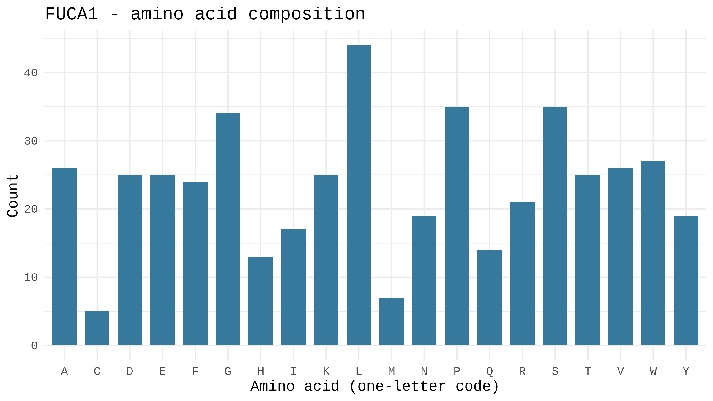
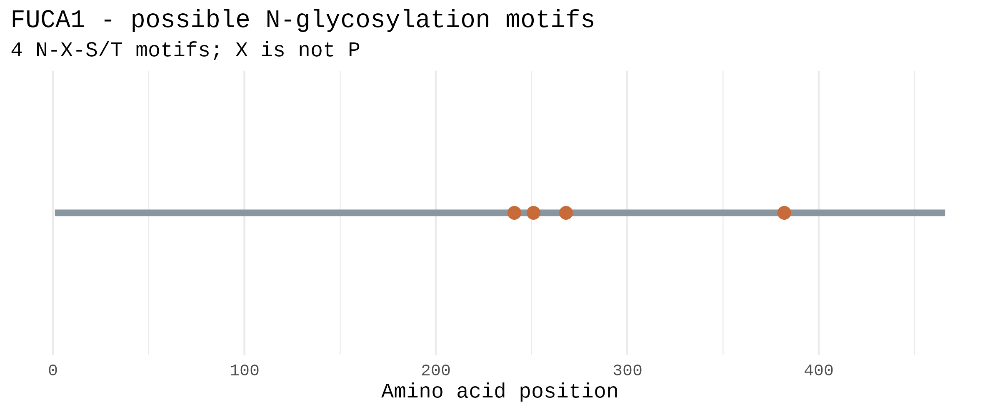

# Lysosomal Enzyme Analysis: FUCA1

**Enzyme:** Tissue alpha-L-fucosidase (gene FUCA1)

**NCBI protein record:** https://www.ncbi.nlm.nih.gov/protein/NP_000138.2

**Function:** FUCA1 is a lysosomal enzyme. It removes fucose sugars from glycoproteins and glycolipids so the cell can recycle the pieces.

I ran everything in R on Google Colab. The protein sequence was downloaded from NCBI by the R script itself. Below, each step shows the code I ran and the result it gave.

## Step 1. Choose the enzyme

I chose FUCA1 from the list of 45 lysosomal enzymes. No classmate picked the same gene.

## Step 2. Find the protein accession in NCBI

| Item | Value |
|---|---|
| Gene | FUCA1 |
| Enzyme | Tissue alpha-L-fucosidase |
| Accession | NP_000138.2 |
| Breaks down | Fucose-containing glycoproteins and glycolipids |

## Step 3. Install the R packages

```r
install.packages(c("rentrez", "ggplot2"))
```

## Step 4. Set my gene and accession

I changed only these two lines at the top of the script. Nothing else in the script was edited.

```r
gene <- "FUCA1"
accession <- "NP_000138.2"
```

## Step 5. Run the script

```r
source("lysosomal_enzyme_analysis.r")
```

Console output:

```
Downloading NP_000138.2 from NCBI Protein...

Analysis complete for FUCA1 (NP_000138.2)
   gene   accession length_amino_acids potential_N_glycosylation_motifs
1 FUCA1 NP_000138.2                466                                4

Five most common amino acids:
 amino_acid count percent
          L    44    9.44
          P    35    7.51
          S    35    7.51
          G    34    7.30
          W    27    5.79

Files saved in data/, results/, and figures/.
```

## Step 6. Proof that the sequence came from NCBI

The script downloads the record with `rentrez::entrez_fetch()` and saves it as `data/FUCA1.fasta`. These are the first lines of that file:

```
>NP_000138.2 tissue alpha-L-fucosidase precursor [Homo sapiens]
MRAPGMRSRPAGPALLLLLLFLGAAESVRRAQPPRRYTPDWPSLDSRPLPAWFDEAKFGVFIHWGVFSVP
AWGSEWFWWHWQGEGRPQYQRFMRDNYPPGFSYADFGPQFTARFFHPEEWADLFQAAGAKYVVLTTKHHE
```

## Step 7. Files the script created

```
data/FUCA1.fasta
figures/FUCA1_amino_acid_composition.png
figures/FUCA1_potential_N_glycosylation.png
results/FUCA1_amino_acid_counts.csv
results/FUCA1_motif_positions.csv
results/FUCA1_summary.csv
```

## Step 8. Results

**Summary (`results/FUCA1_summary.csv`):**

| gene | accession | length_amino_acids | potential_N_glycosylation_motifs |
|---|---|---|---|
| FUCA1 | NP_000138.2 | 466 | 4 |

**Top 5 amino acids (from `results/FUCA1_amino_acid_counts.csv`):**

| amino_acid | count | percent |
|---|---|---|
| L | 44 | 9.44 |
| P | 35 | 7.51 |
| S | 35 | 7.51 |
| G | 34 | 7.30 |
| W | 27 | 5.79 |

**Potential N-glycosylation motifs (`results/FUCA1_motif_positions.csv`):**

| position | motif |
|---|---|
| 241 | NST |
| 251 | NDS |
| 268 | NCS |
| 382 | NTT |

### Figure 1. Amino acid composition


              

              

### Figure 2. Potential N-glycosylation motifs


              

              

## Answers

**1. What does your enzyme normally break down inside lysosomes?**

FUCA1 breaks down fucose-containing glycoproteins and glycolipids. It cuts off the fucose sugar so the rest can be broken down further.

**2. What is the total length of your protein, and which amino acids are most common?**

The protein is 466 amino acids long. This is the precursor form, so it includes the signal peptide. The most common amino acids are leucine (L, 9.44%), proline (P, 7.51%), serine (S, 7.51%).

**3. How many potential N-glycosylation motifs did you find? Where are they?**

I found 4 potential N-X-S/T motifs. They start at positions 241 (NST), 251 (NDS), 268 (NCS), 382 (NTT). These are only predicted sites.

**4. Why can glycosylation matter for lysosomal proteins? Does finding a motif prove the protein is glycosylated?**

Sugars added to lysosomal proteins help them fold correctly and stay stable. They also help the cell send the enzyme to the lysosome. Finding a motif does not prove glycosylation. It only shows where a sugar could be attached. This analysis also does not show a mannose-6-phosphate tag or measure enzyme activity.

**5. What could happen in the cell if your enzyme did not work properly?**

Fucose-containing molecules would build up in the lysosome because they cannot be broken down. Over time this can harm cells. Loss of FUCA1 activity causes fucosidosis, a lysosomal storage disease.
